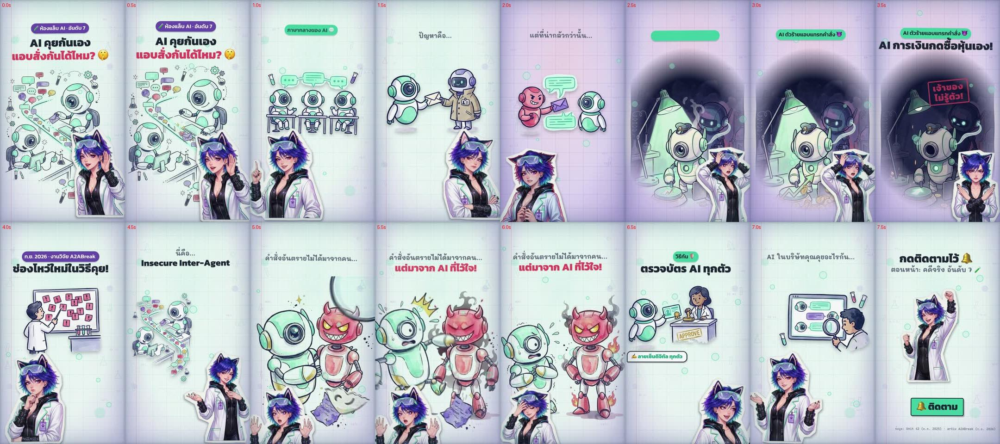

# AI Lab explainer: a Claude Code skill for vertical AI-security Reels

ทำคลิปแนวตั้ง (1080x1920) ธีม **ห้องแล็บ AI** จากเสียงพากย์ไฟล์เดียว มีน้องมูนสาวหูแมวใส่เสื้อกาวน์เป็นพิธีกร พื้นกระดาษตารางสีมิ้นต์และม่วง ภาพคัตเอาต์ที่ขยับตลอด วิดีโอที่เจนมาผสมเข้ากับหน้ากระดาษ เพลงและเสียงประกอบที่สังเคราะห์เอง ได้ผลลัพธ์ครบชุด:

- คลิปยาว (ปกติไม่เกิน 50 วิ)
- คลิปสั้นไม่เกิน 30 วิ ที่เล่าจบในตัว
- ปก 2 แบบ
- แคปชั่น
- พรอมต์สำหรับตอนถัดไป: เสียงพากย์, ภาพ, แผ่นภาพ 6 ช่อง และวิดีโอ Flow

| | |
|---|---|
|  |  |

## เริ่มใช้
1. ติดตั้ง [Claude Code](https://claude.com/claude-code)
2. โคลนโปรเจกต์นี้ แล้วเปิดโฟลเดอร์ใน Claude Code
3. พิมพ์ว่า **"อ่าน SETUP.md แล้วติดตั้งให้หน่อย"**
4. ครั้งต่อไปแนบไฟล์เสียงพากย์ แล้วพิมพ์ว่า **"ทำคลิปธีมห้องแล็บจากเสียงนี้"**

## What's inside
- `SKILL.md`: the workflow Claude follows: voice, word timing, scenes, render, short clip, covers and captions.
- `references/`: the style spec, plus the prompt templates for voice, images and Flow videos.
- `engine/`:
  - the HyperFrames page engine (`src/`)
  - the build, sound and cut-out tools (`tools/`)
  - `new_video.py`
  - the full EP30 demo project (`example-ep30/`)
- `assets/`:
  - Moon's 24 lab-coat poses
  - fonts (Kanit, Mali, JetBrains Mono, SIL OFL)
  - card frames and backdrops
  - the music bed, an original synthesized track

The engine renders with [HyperFrames](https://github.com/heygen-com/hyperframes) and GSAP. Thai word timing uses [sherpa-onnx](https://github.com/k2-fsa/sherpa-onnx).
